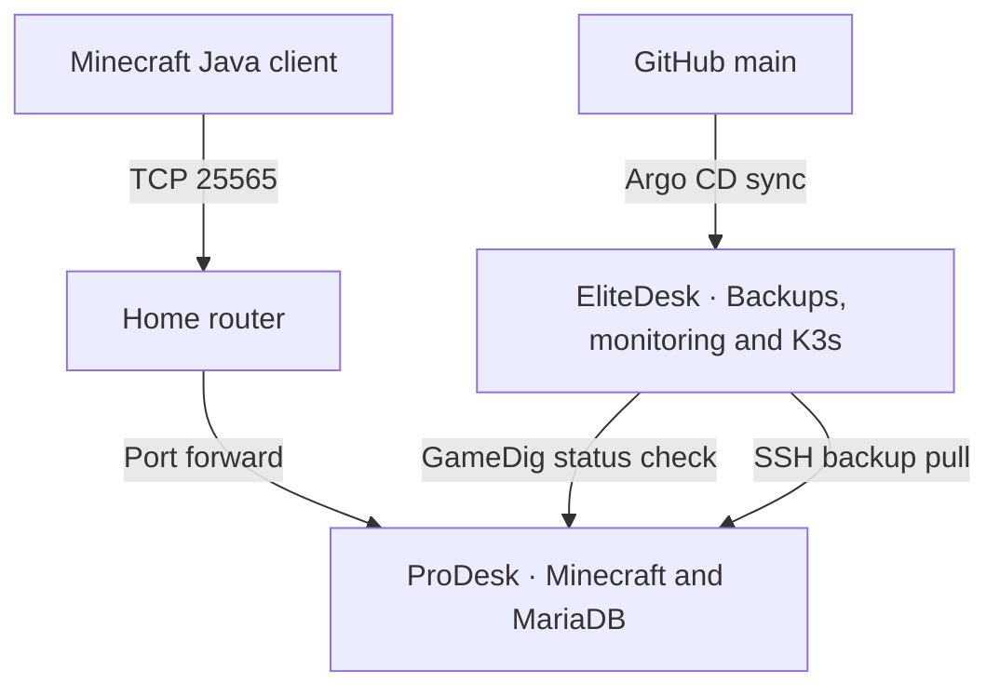
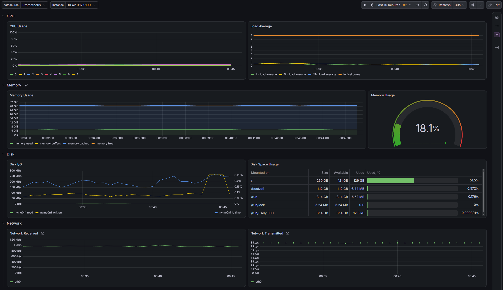

# Minecraft Homelab

I run a Paper Minecraft server on an HP ProDesk and use a separate HP EliteDesk for backups, recovery testing, monitoring, and a single-node K3s lab. Both machines run Ubuntu Server. The setup lets me test recovery and Kubernetes deployments while the game server runs on its own host.

## Architecture



| Host | Role | Services |
| --- | --- | --- |
| **ProDesk** | Minecraft and plugin data | Docker / Compose, Paper, MariaDB 11.4 |
| **EliteDesk** | Recovery and observability | Backup pull timer, Uptime Kuma in Docker, K3s with Argo CD, Prometheus and Grafana |

The documented public game route uses Cloudflare DNS (`mc.tobiaslohre.no`) and TCP `25565` port forwarding. Uptime Kuma checks the game endpoint over the LAN.

Paper keeps its world and plugin files on a persistent Docker mount. LuckPerms and LiteBans use MariaDB for their database storage.

## Backup and recovery

| Copy | Schedule | Retention |
| --- | --- | --- |
| ProDesk server-data archives | Nightly at `04:00 UTC` | Up to 14 days |
| EliteDesk off-host copy | Daily at `06:00 UTC` via `minecraft-backup-pull.timer` | Latest verified nightly archive |

The EliteDesk pulls completed `.tar.gz` archives with a dedicated SSH key restricted to reading backups. The pull job compares SHA-256 checksums before promoting a new copy. A manual run verified the **40 GiB** archive on the EliteDesk.

I tested Minecraft recovery by booting the restored world in a separate container on the EliteDesk. The database test used an on-demand SQL dump and an isolated MariaDB container.

## K3s and GitOps

Argo CD watches the `main` branch. The [NGINX manifest](apps/hello-nginx/hello-nginx.yaml) defines a Deployment with an HTTP readiness probe and a ClusterIP Service in `k3s-lab`.

To test pod recovery, I deleted the running NGINX pod. Kubernetes created a new pod, and the Service returned the NGINX welcome page. To test GitOps, I changed `replicas` from `1` to `2` in GitHub and checked the rollout in Argo CD and K3s.

## Monitoring

**Uptime Kuma** uses a GameDig monitor to query the Minecraft Java server once a minute.

**Prometheus and Grafana** run on K3s via `kube-prometheus-stack`. Argo CD combines the Helm chart with the repo's [monitoring values](apps/monitoring/values.yaml). Both services use `local-path` persistent volumes, and Grafana reads its admin credentials from a Kubernetes Secret.



## Verification

| Check | Observed result | Screenshot |
| --- | --- | --- |
| Minecraft recovery | Paper 1.21.11 started with restored data and responded to a status query. | [Paper restore test](screenshots/minecraft-backup-restore-test.png) |
| Plugin database recovery | MariaDB 11.4 imported the SQL dump, and all 16 plugin tables passed `mariadb-check`. | [MariaDB restore test](screenshots/mariadb-backup-restore-test.png) |
| Game availability | GameDig went from `Down` to `Up` after the game server started. | [Uptime Kuma monitor](screenshots/uptime-kuma-minecraft-monitor.png) |
| GitOps rollout | Argo CD showed `Synced` and `Healthy`. K3s showed `2/2` replicas ready. | [Argo CD scale test](screenshots/argocd-gitops-scale-test.png) |
| Node metrics | Grafana displayed live CPU, memory and disk metrics from Prometheus. | [EliteDesk Grafana dashboard](screenshots/grafana-elitedesk-node-overview.png) |

The initial Docker deployment and connection tests are also in the [screenshot directory](screenshots/).

## Operator checks

Run these on the **ProDesk**.

```bash
sudo docker logs --tail 50 minecraft-survival
sudo tail -n 20 /srv/data/backups/minecraft-nightly/backup.log
```

Run these on the **EliteDesk**.

```bash
systemctl list-timers --all minecraft-backup-pull.timer
sudo journalctl -u minecraft-backup-pull.service -n 20 --no-pager
sudo k3s kubectl -n argocd get applications
sudo k3s kubectl -n monitoring get pods,pvc
```

## Next steps

- Schedule MariaDB dumps and include them in the off-host backup job.
- Send alerts for Minecraft downtime and failed or stale backups.
- Automate host setup with Ansible.
