# Docker Minecraft Homelab Server

## Overview

This project documents a Minecraft server running in Docker on a self-hosted Ubuntu Server homelab machine.

The goal of the project is to learn Docker Compose, persistent volumes, container networking, and basic game server operations in a local infrastructure environment.

The project started on an HP EliteDesk. The ProDesk now runs the Minecraft server and plugin database. The EliteDesk holds a second copy of the game backup, runs recovery tests and service monitoring, and hosts a single-node K3s lab for GitOps.

## Architecture

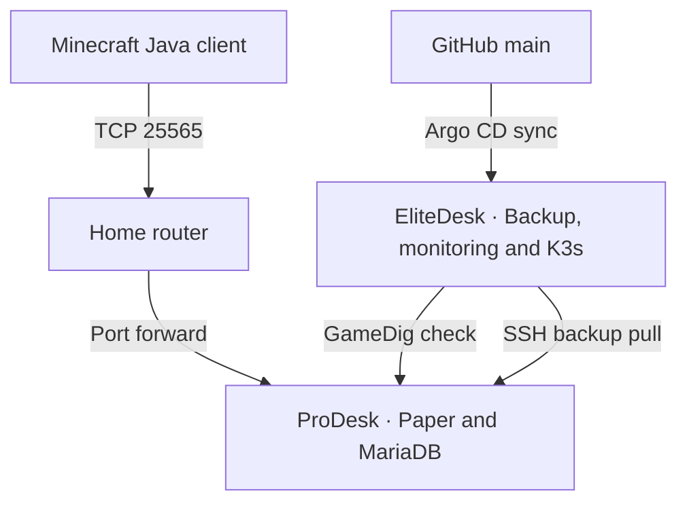

Both hosts run Ubuntu Server. The ProDesk stores Minecraft data and local archives on the drive mounted at `/srv/data`. Its MariaDB container stores data for LuckPerms and LiteBans. The EliteDesk connects to the ProDesk over the LAN for backup and monitoring.

## Tech Stack

- HP ProDesk 600 G4 and HP EliteDesk 705 G5
- Ubuntu Server
- Docker Engine
- Docker Compose
- PaperMC
- Minecraft Java Edition
- MariaDB 11.4
- Cloudflare DNS, OpenSSH, cron and systemd
- K3s and Argo CD
- Uptime Kuma, Prometheus and Grafana

### Hardware

| Host | CPU | Installed RAM | Storage |
| --- | --- | --- | --- |
| **HP ProDesk 600 G4 DM** | Intel Core i5-8500T, 6 cores / 6 threads | 16 GB (1 × 16 GB DDR4) at 2667 MT/s | Samsung SSD 860 SATA, 232.9 GiB (system drive). Corsair MP600 ELITE NVMe, 1.8 TiB at `/srv/data`. |
| **HP EliteDesk 705 G5 Desktop Mini** | AMD Ryzen 5 PRO 3400GE, 4 cores / 8 threads | 32 GB (2 × 16 GB DDR4) at 2667 MT/s | Kioxia KBG30ZMV256G NVMe, 238.5 GiB (system drive). |

## Setup Process

The first deployment ran on the EliteDesk.

- Installed Docker Engine on Ubuntu Server
- Created a Docker Compose configuration
- Deployed a PaperMC Minecraft server container
- Exposed Minecraft port `25565`
- Mounted persistent server data using a local volume
- Configured container restart policy with `unless-stopped`
- Verified the server using Docker logs
- Connected successfully from a Minecraft client on the local network

## Docker Compose Configuration

This is the original single-host Compose example from the EliteDesk deployment.

```yaml
services:
  minecraft:
    image: itzg/minecraft-server:latest
    container_name: minecraft-server
    ports:
      - "25565:25565"
    environment:
      EULA: "TRUE"
      TYPE: "PAPER"
      VERSION: "1.21.4"
      MEMORY: "4G"
      ONLINE_MODE: "TRUE"
      MOTD: "Elitedesk Minecraft Server"
    volumes:
      - ./data:/data
    restart: unless-stopped
```

### Current ProDesk containers

| Container | Image | Role |
| --- | --- | --- |
| `minecraft-survival` | `itzg/minecraft-server:java21` | Paper Survival with a persistent data mount |
| `piraden-mariadb` | `mariadb:11.4` | LuckPerms and LiteBans database storage |

## Useful Commands

Use these commands from the directory with the original Compose example.

| Task | Command |
| --- | --- |
| Start the server | `docker compose up -d` |
| View live logs | `docker logs -f minecraft-server` |
| View recent logs | `docker logs --tail 50 minecraft-server` |
| Check running containers | `docker ps` |
| Restart the server | `docker compose restart` |
| Stop the stack | `docker compose down` |

On the ProDesk, check the current container logs and MariaDB status.

```bash
sudo docker logs --tail 50 minecraft-survival
sudo docker inspect -f 'Image={{.Config.Image}} Status={{.State.Status}}' piraden-mariadb
```

## Current Status

Minecraft Survival and MariaDB ran on the ProDesk during verification. The EliteDesk is a Ready K3s control-plane node, and its backup-pull service passed a manual run with the daily timer enabled.

## Public Access

The Minecraft server was made reachable from outside the local network by configuring router port forwarding and DNS.

| Setting | Value |
| --- | --- |
| Public game address | `mc.tobiaslohre.no` |
| Router port forwarding | TCP `25565` to the Minecraft host |
| DNS provider | Cloudflare |
| Domain registrar | Webhuset |

The DNS record points to the public IP address, while the router forwards Minecraft traffic on TCP port `25565` to the internal Ubuntu Server running the Docker container.

## Automated Backups

An automated backup script was created to back up the Minecraft server data directory.

### Initial EliteDesk backup job

The original backup script saved the Minecraft world with `rcon-cli save-all`, compressed the persistent `./data` directory into a timestamped `.tar.gz` archive, and removed backups older than 14 days.

The original cron entry ran daily at 04:00.

```cron
0 4 * * * /home/tobias/scripts/minecraft-backup.sh >> /home/tobias/backups/minecraft/backup.log 2>&1
```

The original setup used `~/scripts/minecraft-backup.sh` for manual runs. I checked the backup directory and listed an archive with `tar -tzf` to verify that it contained the server's `data/` directory.

### ProDesk archives and EliteDesk copy

| Copy | Schedule | Retention |
| --- | --- | --- |
| ProDesk server-data archive in `/srv/data/backups/minecraft-nightly` | Nightly at 04:00 UTC | Up to 14 days |
| EliteDesk copy in `~/backups/minecraft` | Daily at 06:00 UTC via `minecraft-backup-pull.timer` | Latest verified nightly archive |

The ProDesk job saves the world, stops the Minecraft container while creating the archive, and restarts it after archiving. The EliteDesk job pulls the latest completed archive over SSH. It checks the SHA-256 checksum before replacing the current copy. A manual run verified the **40 GiB** archive on the EliteDesk.

Check the nightly backup log on the **ProDesk**.

```bash
sudo tail -n 20 /srv/data/backups/minecraft-nightly/backup.log
```

Check the copy schedule and most recent service run on the **EliteDesk**.

```bash
systemctl list-timers --all minecraft-backup-pull.timer
sudo journalctl -u minecraft-backup-pull.service -n 20 --no-pager
```

## Restore Test

### Initial archive extraction

The first restore test extracted the backup into a separate test directory.

The test checked the following items.

- The backup archive could be extracted successfully
- The restored `data/` directory was present
- The archive included all three world directories
  - `world`
  - `world_nether`
  - `world_the_end`
- The restored data size matched the live server data size

These commands use the original archive layout with a top-level `data/` directory.

```bash
archive="$HOME/backups/minecraft/minecraft-backup-2026-05-25_17-11-47.tar.gz"
restore_dir=$(mktemp -d "$HOME/minecraft-restore.XXXXXX")
tar -xzf "$archive" -C "$restore_dir"
ls -lh "$restore_dir/data"
du -sh "$HOME/docker/minecraft-server/data" "$restore_dir/data"
```

### Minecraft startup from the off-host copy

I inspected the nightly archive on the EliteDesk before restoring it. The archive listed **83.1 GiB** of uncompressed files, including `level.dat` for the overworld, Nether, and End.

I started **Paper 1.21.11** in a separate Docker test container with the restored world data. Paper logged `Done`, and a Minecraft status query returned the version and the test server's MOTD, `EliteDesk restore test`.

Run the status query while the restore container is active.

```bash
sudo docker exec minecraft-restore-test mc-monitor status --host 127.0.0.1 --port 25565
```

### MariaDB plugin data recovery

I exported the LuckPerms and LiteBans schemas on demand, verified the dump's SHA-256 checksum on the EliteDesk, and imported it into an isolated **MariaDB 11.4** container. All **16** tables passed `mariadb-check`, and the restored LuckPerms database contained seven groups.

## K3s and GitOps

The EliteDesk runs a single-node K3s cluster with Traefik and ServiceLB disabled. Argo CD tracks the repo's `main` branch. The [NGINX manifest](apps/hello-nginx/hello-nginx.yaml) defines a Deployment with an HTTP readiness probe and a ClusterIP Service in the `k3s-lab` namespace.

I checked two behaviors in the lab.

| Test | Observed result |
| --- | --- |
| Pod replacement | After I deleted the running NGINX pod, Kubernetes created a new pod and the Service returned the NGINX welcome page. |
| Git-driven rollout | I changed `replicas` from `1` to `2` in GitHub. Argo CD reported `Synced` and `Healthy`, and the Deployment showed `2/2` ready. |

Inspect the node, Argo CD application, and deployed resources on the **EliteDesk**.

```bash
sudo k3s kubectl get nodes
sudo k3s kubectl -n argocd get application hello-nginx
sudo k3s kubectl -n k3s-lab get deploy,pods,svc
```

## Monitoring

### Uptime Kuma

I deployed Uptime Kuma using Docker Compose for a TCP check against the public Minecraft endpoint, `mc.tobiaslohre.no:25565`. The initial dashboard used port `3001`, with a LAN-scoped UFW rule in the firewall configuration.

Uptime Kuma now runs on the EliteDesk and checks the ProDesk Minecraft service over the LAN with GameDig every 60 seconds. The monitor recorded a `Down` to `Up` transition after the game server started.

### Prometheus and Grafana

Argo CD deploys `kube-prometheus-stack` to the `monitoring` namespace using the upstream Helm chart and the repo's [monitoring values](apps/monitoring/values.yaml). Prometheus collects node and Kubernetes metrics. Grafana's Node Exporter dashboard showed CPU, memory, disk and network panels with live data.

| Component | Storage | Configuration |
| --- | --- | --- |
| Prometheus | 10 GiB `local-path` persistent volume claim | Retention settings of 7 days and 6 GB |
| Grafana | 1 GiB `local-path` persistent volume claim | Admin credentials in a Kubernetes Secret |

Argo CD reported `Synced` and `Healthy` for monitoring. The pods were running and both persistent volume claims were bound.

```bash
sudo k3s kubectl -n argocd get application monitoring
sudo k3s kubectl -n monitoring get pods,pvc,svc
```

## Server Hardening

Basic server hardening was applied to reduce the attack surface of the homelab server.

### Initial EliteDesk setup

- SSH key authentication enabled
- Password-based SSH login disabled
- Root SSH login disabled
- Keyboard-interactive authentication disabled
- SSH configuration validated using `sshd -t`
- SSH access tested using public key authentication
- fail2ban installed and enabled for SSH protection

The initial deployment recorded these effective SSH settings.

```text
pubkeyauthentication yes
passwordauthentication no
kbdinteractiveauthentication no
permitrootlogin no
```

The `sshd` jail was active in fail2ban during that verification.

### Current backup access

The backup pull uses a dedicated EliteDesk SSH key. The ProDesk restricts that key to a read-only command for completed archives, and the EliteDesk verifies the ProDesk's host key.

## Screenshots

### Two-host verification

#### Grafana host metrics


#### Minecraft restore

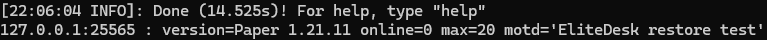

#### MariaDB restore

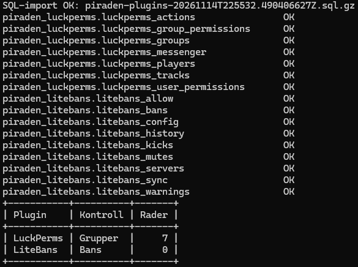

#### Minecraft availability

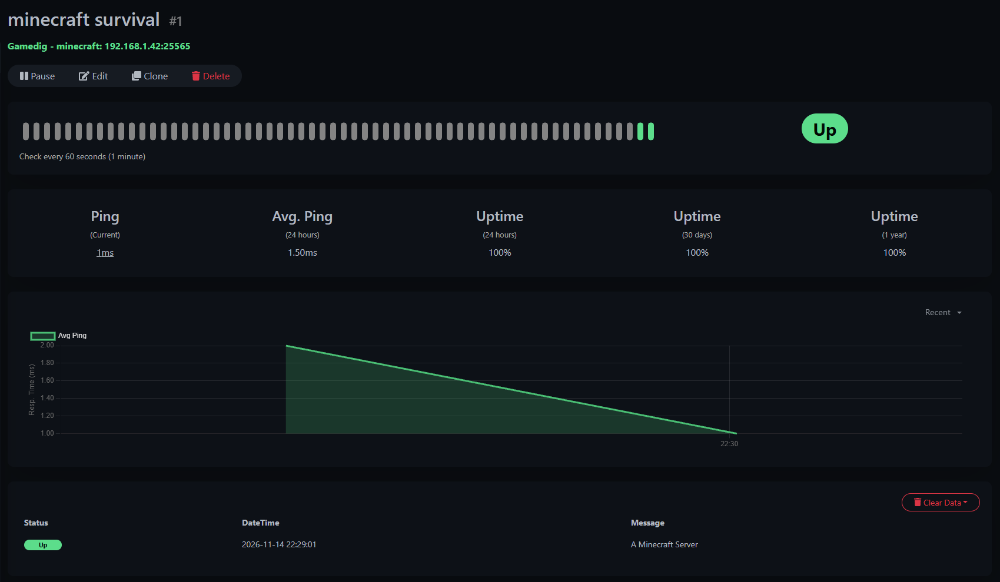

#### Argo CD rollout

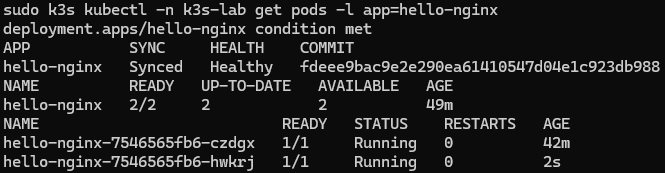

### Initial setup

These screenshots show Docker verification, the Docker Compose configuration, the running Minecraft container, successful port testing, and a Minecraft client connection through the configured domain.

#### Docker Installation Verified
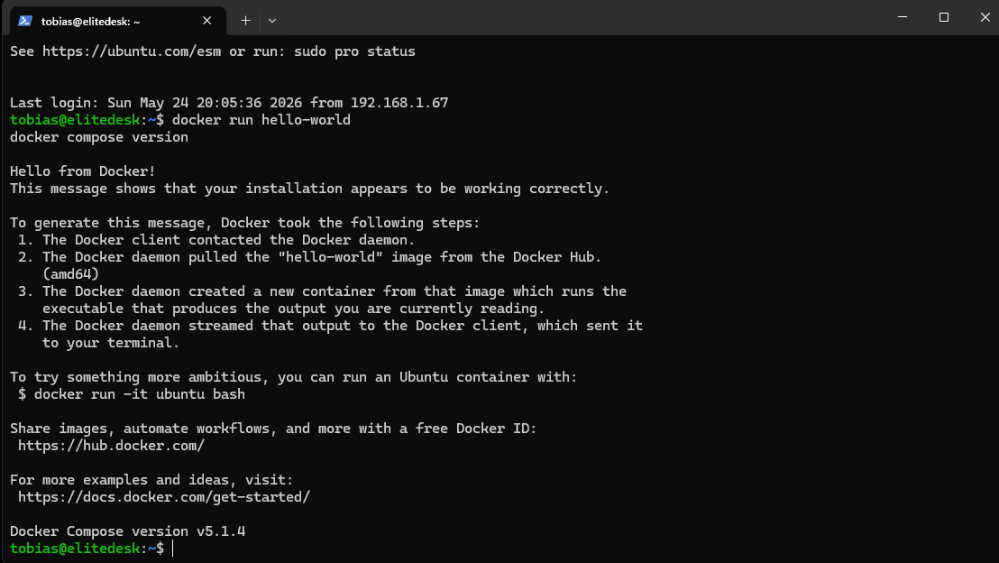

#### Docker Compose Configuration
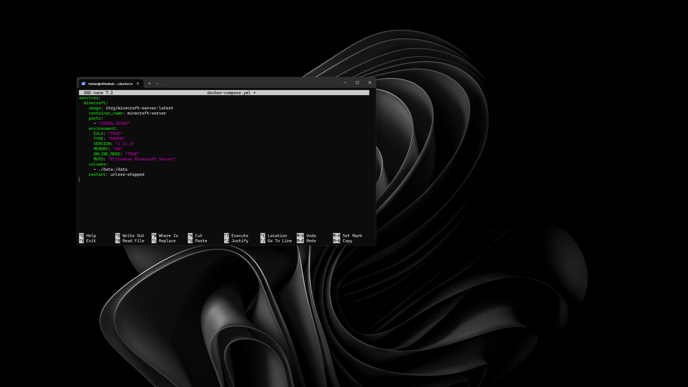

#### Docker Container Running
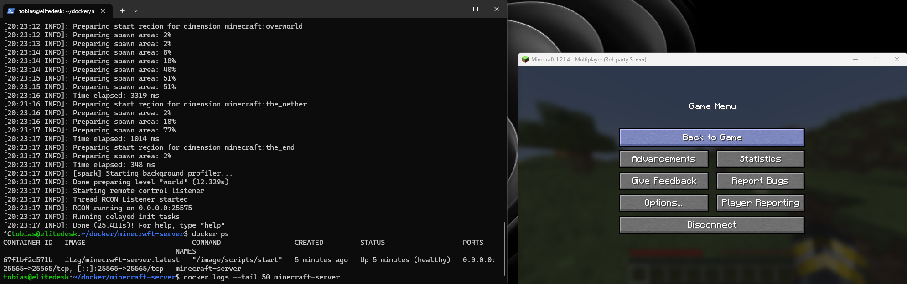

#### Minecraft Client Connected
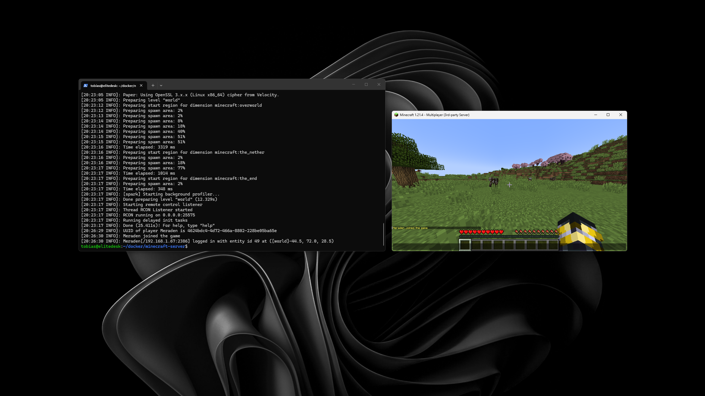

#### Minecraft Domain Port Test
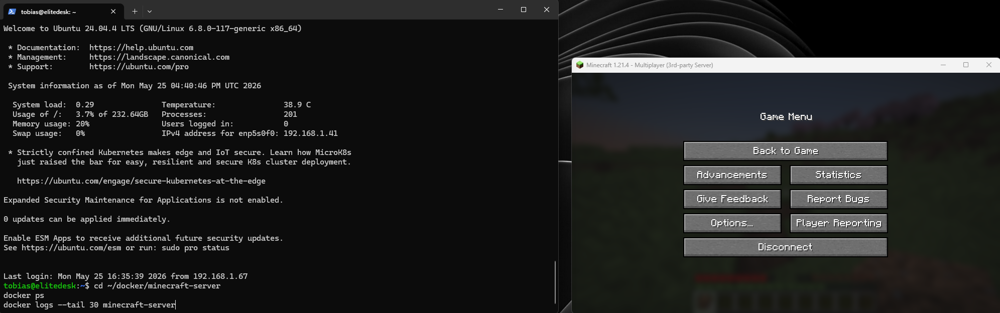

#### Minecraft Domain Connection
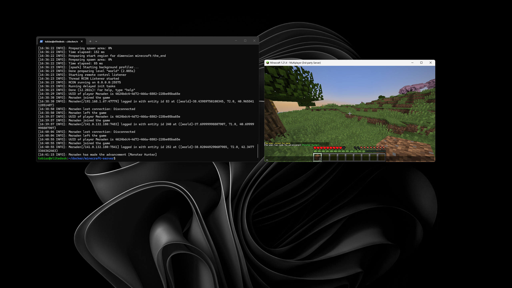

#### Automated Backup Verified
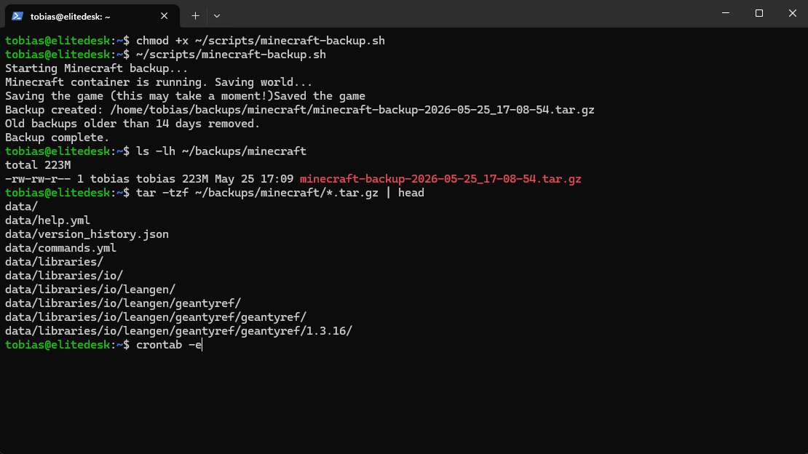

#### Uptime Kuma Monitoring
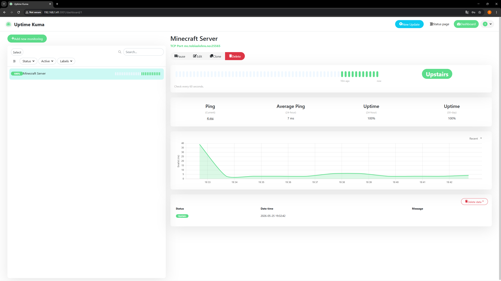

#### Server Hardening Verified
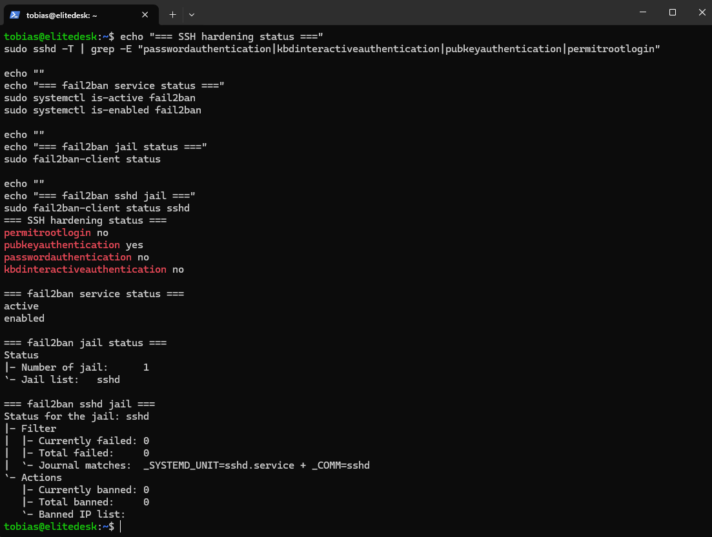

## Key Learnings

- Docker Compose service configuration
- Container port mapping
- Persistent volume usage for server data
- Basic container lifecycle management
- Reading container logs for troubleshooting
- Hosting a service on a self-managed Linux server
- Difference between local network hosting and public internet exposure
- Basic service monitoring with Uptime Kuma
- TCP port monitoring for public services
- Restricting internal admin dashboards to the local network
- Off-host backup copies with checksum verification
- Testing Minecraft and database recovery in separate containers
- Kubernetes readiness probes, pod replacement and GitOps rollouts
- Collecting and inspecting node metrics with Prometheus and Grafana

## Security Note

The public route documented here is Minecraft on TCP `25565`. Administrative access takes place on the LAN. Grafana uses a ClusterIP Service and was accessed through port forwarding.

## Future Improvements

- Verify the scheduled EliteDesk copy and archive rotation with a new nightly backup
- Schedule MariaDB exports and copy them to the EliteDesk
- Add alert notifications for service downtime
- Automate deployment with Ansible
